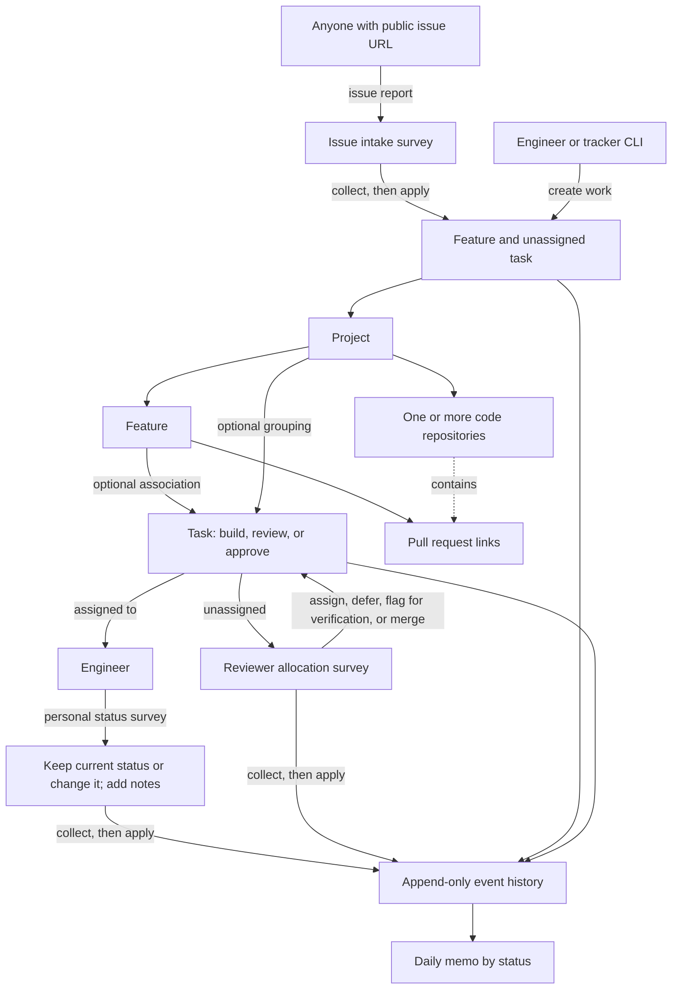

# ep-tracker

`ep-tracker` is an agent-first Python CLI for running a team's work tracker in
Git. A team keeps one tracker repository, separate from the code repositories
it tracks. People and agents use `tracker` commands; they do not edit tracker
JSON or event files by hand.

## How the tracker is organized

- **People** represent engineers and other team members. Engineers can own
  features and tasks; reviewers can be selected to allocate unassigned work.
- **Projects** group related work and one or more code repositories.
- **Features** describe a larger piece of work within a project. A feature can
  link pull requests from multiple repositories in that project. Its folder
  contains a `README.md` for notes and an `images/` directory for supporting
  images.
- **Tasks** are actionable work. They may belong to a feature or stand alone;
  an optional project can group a standalone task. A task can be assigned to a
  person and can represent building, reviewing, or approving work.
- **Surveys** collect task updates, allocate unassigned work, or report new
  issues. Survey responses become tracker events only when explicitly applied.
- **Daily memos** summarize features and tasks by status in a dated snapshot.



The event history under `.tracker/events/` is the authoritative state. The CLI
derives current people, projects, repositories, features, tasks, assignments,
statuses, and pull request links from these append-only events. Feature
README files and images are working documents tracked in Git; memos are
immutable dated snapshots. `.tracker/private/` holds survey links and raw
responses and is gitignored.

## Install and create a team tracker

```bash
uv tool install --editable .
tracker --help

tracker init ./team-tracker --name "Platform"
cd ./team-tracker
tracker person add --id alex --name "Alex Kim" --github alexkim
tracker project add --id billing --name "Billing"
tracker project repo --id billing-api --project billing --url https://github.com/acme/billing-api
tracker feature create --id saved-cards --project billing --title "Saved cards" --assignee alex
tracker task create --id saved-cards-build --feature saved-cards --title "Implement saved cards" --assignee alex
tracker feature pr saved-cards --repo billing-api --url https://github.com/acme/billing-api/pull/42 --number 42
tracker memo build
```

People default to the `engineer` role. Use `tracker person add --role <role>`
for reviewers or other team members who should not appear in engineer
assignment choices. A feature can have multiple tasks and pull request links.
Link each PR to a registered repository in the feature's project. Tasks can
also be created without a feature, either independently or grouped under a
project:

```bash
tracker task create --id rotate-keys --project billing --title "Rotate API keys" --kind other
tracker task create --id review-runbook --title "Review incident runbook" --kind review
```

Every command emits one JSON envelope to stdout. Event files are stored one per
file to avoid concurrent Git changes colliding on a shared JSONL file. Commit
and share the tracker repository with the same review workflow used for code.

## A team's regular workflow

1. Run `tracker agent next` for state-aware guidance, or `tracker status` for a
   current overview. `tracker guide` describes the CLI workflow.
2. Add people, projects, and repositories. Create features for larger goals,
   then add build, review, or approval tasks and assign them when known. Create
   standalone tasks directly with `tracker task create` when there is no
   feature to attach them to.
3. Link pull requests to the feature as work lands across the project's code
   repositories. Keep feature notes and images in its folder.
4. Use surveys to gather updates from engineers and make decisions about
   unassigned work. Use the public issue form when people need to report new
   work.
5. Apply collected responses to append events, inspect `tracker status`, and
   build the daily snapshot with `tracker memo build`.

## Humanize surveys

Install the optional EDSL integration with:

```bash
uv tool install --editable '.[fielding]'
```

Each survey lifecycle is explicit: **prepare** creates local EDSL artifacts;
**deploy** creates live Humanize forms; **collect** saves responses privately;
**apply** appends tracker events. Preparing or reviewing a survey does not
deploy it. Do not commit or share `.tracker/private/`.

### Engineer task updates

An update round creates one personalized survey for each active team member.
For every active task assigned to that person, it displays the tracker status
recorded when the survey was prepared and asks whether to keep it or change it.
The engineer can add an optional progress note, blocker, or general update. A
“keep current status” answer does not append a status-change event; notes are
still recorded. Done and cancelled tasks are not included.

```bash
tracker updates prepare --id 2026-11-22
tracker updates deploy 2026-11-22
# Send each returned respondent URL only to its named engineer.
tracker updates collect 2026-11-22
tracker updates apply 2026-11-22
```

### Allocate unassigned tasks

One named reviewer gets a survey containing all active unassigned tasks,
including standalone tasks, and available engineers. For each task, the reviewer can assign it, leave it
unassigned, flag it as probably complete, or merge it into another active task
in the same project. A probable-completion flag is a request to verify; it does
not mark the task done. A merge preserves the original task in history and
records its surviving task ID.

```bash
tracker assignments prepare --id allocation-2026-11-22 --reviewer alex
tracker assignments deploy allocation-2026-11-22
# Send the returned private link to the named reviewer.
tracker assignments collect allocation-2026-11-22
tracker assignments apply allocation-2026-11-22
```

### Public issue reporting

Issue intake creates a reusable public respondent URL. The form asks who is
reporting, which project the issue concerns, a title and description, and
optional email and relevant URLs. Tell respondents their reports become
visible to the team when applied. Each valid report creates a feature with a
README containing the description and links, plus an unassigned task for team
triage.

```bash
tracker intake prepare --id public-issues
tracker intake deploy public-issues
# Share the public respondent URL intentionally.
tracker intake collect public-issues
tracker intake apply public-issues
```

### Survey discovery and privacy

Use `tracker survey guide` for the available survey types and exact commands.
Use `tracker survey list` to see rounds and whether they are prepared,
deployed, collected, or applied; it does not print respondent links. Filter by
type with `tracker survey list --type issue_report`, `tracker survey list
--type task_assignment`, or `tracker survey list --type task_status_update`.

Private respondent links and raw Results artifacts are stored under
`.tracker/private/`. Engineer update and reviewer assignment links are private
and should go only to the intended respondent. Issue intake links are public
and reusable, so share them intentionally.

## Daily memo

Build a dated team snapshot with:

```bash
tracker memo build
```

The memo groups features and tasks by status and preserves each date as an
immutable Markdown snapshot. To create another snapshot after one has been
made for a date, choose a different date.

## Agent guidance

The repository includes [AGENTS.md](AGENTS.md) for agents contributing to this
Python project. Each tracker created by `tracker init` also receives an
`AGENTS.md` with that team's workflow guidance. From a team tracker, agents
should run `tracker agent next` before taking action and again after material
changes. `tracker next` is an alias.
